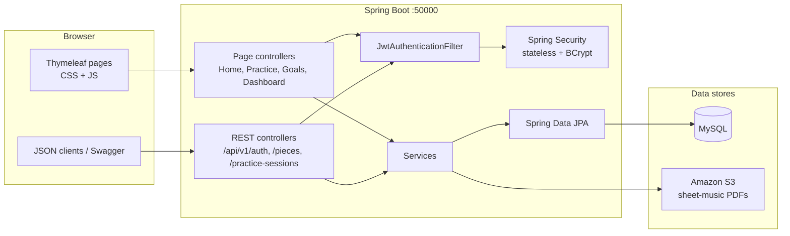
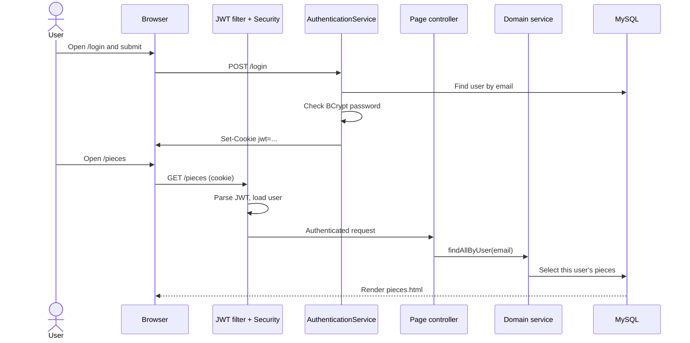
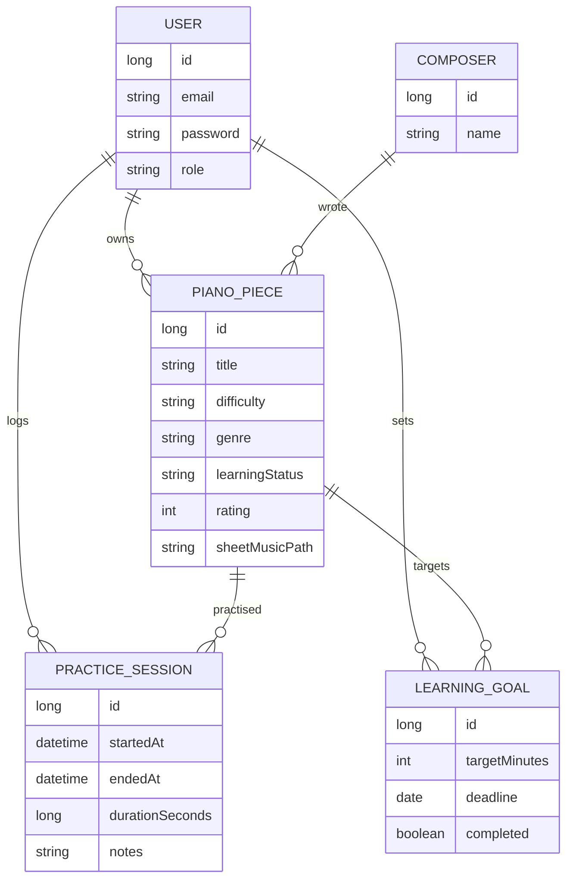

# Piano Piece Tracker

A Spring Boot studio for managing a personal piano repertoire: pieces, sheet music PDFs, timed practice sessions, and learning goals.

[](https://gitdiagram.com/khvostiv/music-practice-management-system/video)

[](https://gitdiagram.com/khvostiv/music-practice-management-system/video)

**Open the app on GitHub Pages:** [khvostiv.github.io/music-practice-management-system](https://khvostiv.github.io/music-practice-management-system/)

The Pages site is a clickable UI preview. Login, search, the practice timer, and navigation all work in the browser. Saving to a database still requires the Java app below.

[README page](https://khvostiv.github.io/music-practice-management-system/readme.html) · [Login](https://khvostiv.github.io/music-practice-management-system/) · [Pieces](https://khvostiv.github.io/music-practice-management-system/pieces.html)


## Features

- Register and log in with JWT cookies
- Track piano pieces (title, composer, genre, difficulty, learning status, rating)
- Upload sheet-music PDFs
- Start a practice timer, add notes, and keep history
- Create learning goals with a minute target and a deadline
- Dashboard totals for pieces, practice time, and goals

## Screens

| Pieces | Dashboard | Practice |
| --- | --- | --- |
|  |  |  |

## How the app is built

This is a **layered Spring Boot 4** application on **Java 21**. The browser talks to two fronts on the same server (port `50000`):

1. **Thymeleaf pages** — HTML forms and lists for login, pieces, practice, goals, and the dashboard
2. **REST API** under `/api/v1/` — JSON for auth, pieces, and practice sessions (used by tools such as Swagger)

Both fronts share the same security, services, and database.



### Request path

A typical page request is assembled like this:

1. The browser hits a URL such as `GET /pieces` or `POST /practice/save`.
2. **Spring Security** runs first. Public routes (`/login`, `/register`, `/css/**`, `/js/**`) pass through. Everything else needs a valid user.
3. **JwtAuthenticationFilter** looks for a JWT in the `Authorization: Bearer` header or in the `jwt` httpOnly cookie. If the token is valid, it loads the user by email and puts them in the security context.
4. A **controller** reads the form or JSON body, then calls a **service**.
5. The service uses a **repository** (and S3 for PDFs). Each query is scoped to the signed-in user so one account cannot see another’s pieces.
6. Page controllers return a Thymeleaf template. REST controllers return JSON.

Login and register mint a JWT, store it in the cookie, and redirect to `/pieces`. Logout clears that cookie.



### Layers in the repo

| Layer | Package | Role |
| --- | --- | --- |
| Pages | `controllers` (`HomeController`, `PracticePageController`, `LearningGoalController`, `DashboardController`) | Map URLs to Thymeleaf templates and form posts |
| REST | `controllers` (`AuthenticationController`, `PianoPieceController`, `PracticeSessionController`) | JSON API under `/api/v1/` |
| Security | `config` | Filter chain, JWT filter, password encoder |
| Services | `services` | Login, pieces, practice math, goals, dashboard totals, S3 uploads |
| Persistence | `repositories` + `beans` | JPA entities and Spring Data queries |
| View | `src/main/resources/templates` + `static` | HTML, CSS, and the practice timer script |

### Data model

A **User** owns piano pieces, practice sessions, and learning goals. Each **PianoPiece** has a **Composer**, a genre, a learning status, and optional sheet music stored in S3. Practice time on a piece feeds both history and goal progress.



### Frontend

Thymeleaf templates in `src/main/resources/templates` are filled on the server. Shared studio CSS/JS live in `src/main/resources/static`. The practice page uses `practice.js` to run the timer in the browser, then posts start/end timestamps when the session is saved.

`docs/` is a static snapshot of those screens for GitHub Pages. It does not talk to MySQL.

## Run locally

### Docker

```bash
docker compose up --build
```

The app is at [http://localhost:50000](http://localhost:50000).

### Maven

You need Java 21 and MySQL with a database named `ajf` (user `root`, password `1234` by default).

```bash
./mvnw spring-boot:run
```

Override the datasource if needed:

```bash
export SPRING_DATASOURCE_URL=jdbc:mysql://localhost:3306/ajf
export SPRING_DATASOURCE_USERNAME=root
export SPRING_DATASOURCE_PASSWORD=1234
./mvnw spring-boot:run
```

## Tech

- Java 21, Spring Boot 4, Spring Security, Thymeleaf
- MySQL (H2 can be used for local UI work)
- JWT cookie authentication
- Optional Amazon S3 storage for PDFs

## Project layout

```
src/main/java/.../controllers   Web pages and REST
src/main/java/.../services      Business rules
src/main/java/.../repositories  JPA access
src/main/java/.../beans         Entities
src/main/resources/templates    Thymeleaf views
src/main/resources/static       CSS and JavaScript
docs/                           GitHub Pages preview
```

## GitHub Pages

The `docs/` folder is a static copy of the studio so the design can be opened without starting Spring Boot.

GitHub has to be told once where the site lives. In the repository:

1. Open **Settings → Pages**
2. Under **Build and deployment**, set **Source** to **Deploy from a branch**
3. Set **Branch** to `main` and the folder to `/docs`
4. Click **Save**

After a minute the app is at [https://khvostiv.github.io/music-practice-management-system/](https://khvostiv.github.io/music-practice-management-system/) and the README page is at [https://khvostiv.github.io/music-practice-management-system/readme.html](https://khvostiv.github.io/music-practice-management-system/readme.html).
