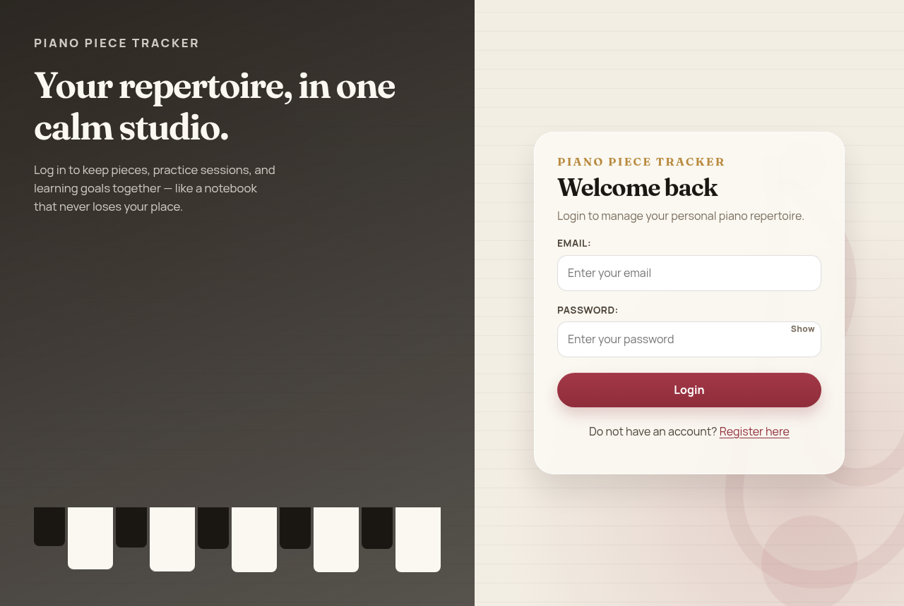
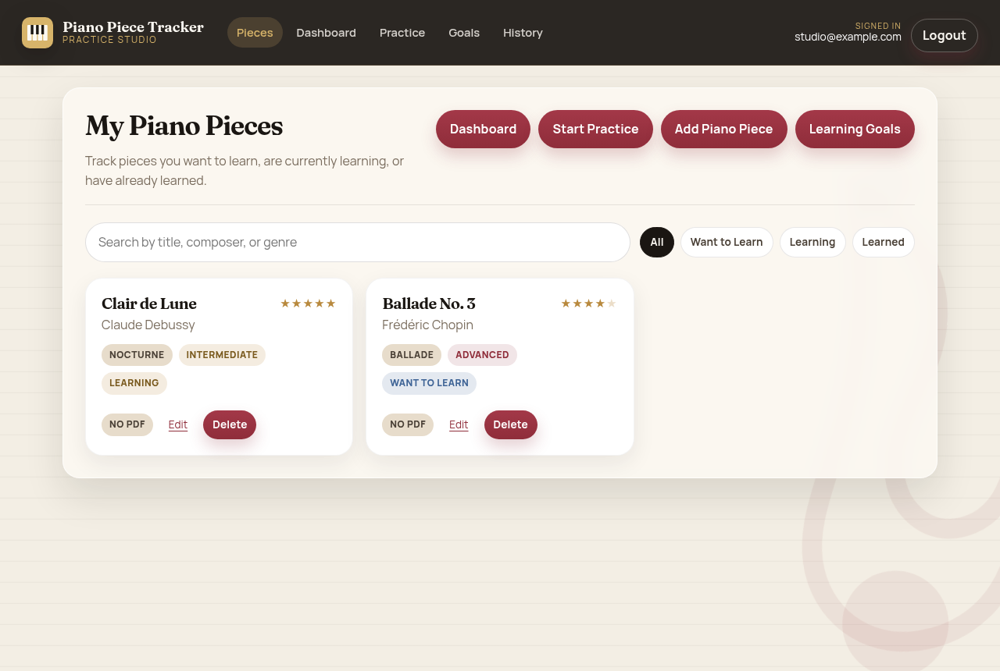
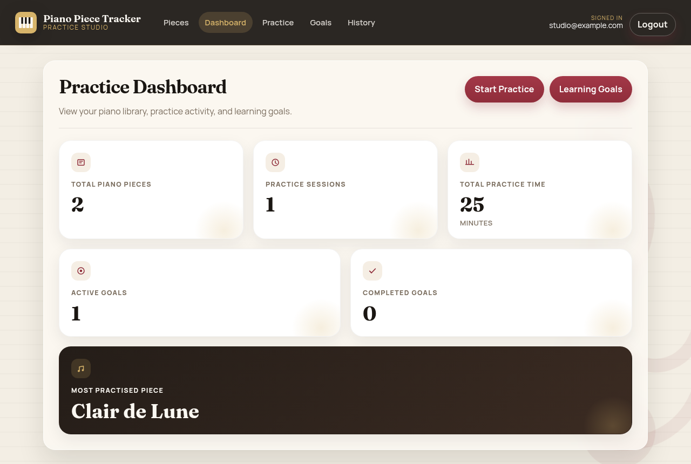
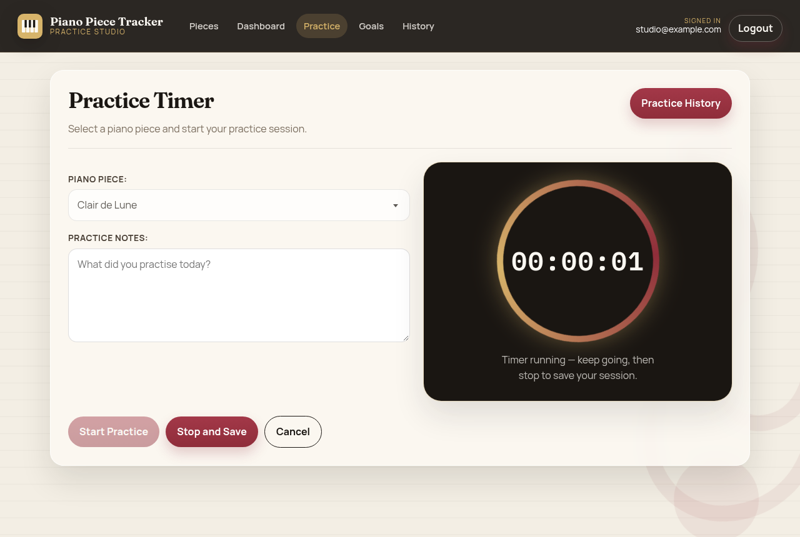

# Piano Piece Tracker

A Spring Boot studio for managing a personal piano repertoire: pieces, sheet music PDFs, timed practice sessions, and learning goals.

**Open the app on GitHub Pages:** [khvostiv.github.io/music-practice-management-system](https://khvostiv.github.io/music-practice-management-system/)

The Pages site is a clickable UI preview. Login, search, the practice timer, and navigation all work in the browser. Saving to a database still requires the Java app below.

[README page](https://khvostiv.github.io/music-practice-management-system/readme.html) · [Login](https://khvostiv.github.io/music-practice-management-system/) · [Pieces](https://khvostiv.github.io/music-practice-management-system/pieces.html)



## Features

- Register and log in with JWT cookies
- Track piano pieces (title, composer, genre, difficulty, learning status, rating)
- Upload sheet-music PDFs
- Start a practice timer, add notes, and keep history
- Create learning goals with a minute target and deadline
- Dashboard totals for pieces, practice time, and goals

## Screens

| Pieces | Dashboard | Practice |
| --- | --- | --- |
|  |  |  |

## Run locally

### Docker

```bash
docker compose up --build
```

The app is at [http://localhost:50000](http://localhost:50000).

### Maven

You need Java 21 and MySQL with a database named `ajf` (user `root`, password `1234` by default).

```bash
./mvnw spring-boot:run
```

Override the datasource if needed:

```bash
export SPRING_DATASOURCE_URL=jdbc:mysql://localhost:3306/ajf
export SPRING_DATASOURCE_USERNAME=root
export SPRING_DATASOURCE_PASSWORD=1234
./mvnw spring-boot:run
```

## Tech

- Java 21, Spring Boot 4, Spring Security, Thymeleaf
- MySQL (H2 can be used for local UI work)
- JWT cookie authentication
- Optional Amazon S3 storage for PDFs

## Project layout

```
src/main/java/.../controllers   Web pages and REST
src/main/resources/templates    Thymeleaf views
src/main/resources/static       CSS and JavaScript
docs/                           GitHub Pages preview
```

## GitHub Pages

The `docs/` folder is a static copy of the studio so the design can be opened without starting Spring Boot. GitHub Pages is enabled from `main` using that folder (and a deploy workflow).
